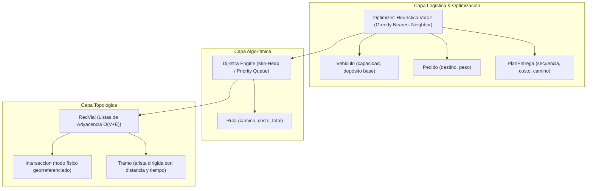

# 🚚 Urban Logistics Route Optimizer (VRP & Navigation Engine)

[](https://github.com/mauroflesia/optimizador-logistica-urbana/actions)

-brightgreen)


Motor de ruteo y optimización para logística urbana de **Última Milla** (Vehicle Routing Problem con restricciones de capacidad) y navegación punto a punto en redes viales dirigidas con pesos variables (distancia y tiempo de tráfico).

Desarrollado bajo los principios de **Clean Code**, **Responsabilidad Única (SRP)**, **Fail-Fast** y **Test-Driven Development (TDD)** con cobertura total.

---

## 🏛️ Arquitectura del Sistema

El proyecto sigue una separación estricta en tres capas desacopladas:



---

## ⚡ Análisis de Complejidad Temporal y Espacial

| Componente | Estructura / Algoritmo | Complejidad Temporal | Complejidad Espacial | Justificación Técnica |
| :--- | :--- | :--- | :--- | :--- |
| **Topología Vial** | Listas de Adyacencia (`dict[str, list[Tramo]]`) | **$O(1)$** inserción / consulta adyacentes | **$O(V + E)$** | Ideal para grafos dispersos como redes viales urbanas (bajo grado medio de esquinas). |
| **Rutas Mínimas** | Dijkstra con Min-Heap (`heapq`) | **$O((V + E) \log V)$** | **$O(V)$** | Extracción del nodo mínimo en tiempo logarítmico frente a búsquedas lineales $O(V^2)$. |
| **Despachos Última Milla**| Heurística Voraz (*Greedy Nearest Neighbor*) | **$O(K \cdot (V + E) \log V)$** | **$O(V + K)$** | Resuelve la secuencia de $K$ paradas en tiempo real respetando restricciones de carga máxima ($O(1)$ evaluación de peso). |

---

## 🧪 Estrategia de Testing (TDD)

El proyecto cuenta con **21 pruebas unitarias** que cubren casos nominales, bordes y defensas:
- **Integridad Referencial:** Validación de tramos con intersecciones no registradas.
- **Valores Límite (Boundary Values):** Pruebas parametrizadas (`@pytest.mark.parametrize`) para rechazo de distancias $\le 0$ y tiempos $\le 0$.
- **Caminos Alternativos & Criterios:** Dijkstra prioriza menor distancia vs menor tiempo en congestión vehicular.
- **Grafos Desconectados:** Manejo seguro de destinos inalcanzables (`Ruta | None`).
- **Restricción de Capacidad:** El optimizador aborta la carga de pedidos que excedan el remanente del móvil y asegura el retorno al depósito.
- **Casos Vacíos:** Retorno al depósito en costo cero cuando la lista de pedidos es vacía.

---

## 🚀 Instalación y Uso Rápido

### 1. Clonar el repositorio
```bash
git clone https://github.com/mauroflesia/optimizador-logistica-urbana.git
cd optimizador-logistica-urbana
```

### 2. Instalar dependencias
```bash
pip install -r requirements.txt
```

### 3. Ejecutar la suite de pruebas
```bash
pytest -v
```

---

## 💻 Ejemplo de Uso (Python API)

```python
from src.graph import RedVial
from src.models import Interseccion, Tramo, Vehiculo, Pedido
from src.optimizer import optimizar_ruta_entregas

# 1. Configurar la Red Vial
red = RedVial()
red.agregar_interseccion(Interseccion("DEP", "Centro de Distribución", (-34.60, -58.38)))
red.agregar_interseccion(Interseccion("C1", "Cliente Norte", (-34.58, -58.40)))
red.agregar_interseccion(Interseccion("C2", "Cliente Sur", (-34.62, -58.37)))

# Conectar tramos viales (origen, destino, distancia_km, tiempo_mins)
red.conectar_intersecciones(Tramo("DEP", "C1", 5.0, 12.0))
red.conectar_intersecciones(Tramo("C1", "C2", 4.0, 8.0))
red.conectar_intersecciones(Tramo("C2", "DEP", 6.0, 15.0))
red.conectar_intersecciones(Tramo("C1", "DEP", 5.0, 12.0))

# 2. Configurar Vehículo y Pedidos
vehiculo = Vehiculo(deposito_id="DEP", carga_maxima=100.0)
pedidos = [
    Pedido(id="P-01", destino_id="C2", peso=30.0),
    Pedido(id="P-02", destino_id="C1", peso=20.0),
]

# 3. Planificar Jornada Voraz
plan = optimizar_ruta_entregas(red, vehiculo, pedidos, criterio="distancia")

print(f"Entregas en orden: {plan.pedidos_entregados}")  # ['P-02', 'P-01']
print(f"Ruta GPS: {' -> '.join(plan.camino_completo)}")  # DEP -> C1 -> C2 -> DEP
print(f"Distancia Total: {plan.costo_total} km")        # 15.0 km
```

---

## 🛠️ Tecnologías y Buenas Prácticas

- **Lenguaje:** Python 3.10+
- **Testing:** Pytest
- **Algoritmia:** Min-Heap (`heapq`), Dijkstra, Greedy Algorithms
- **Patrones & Arquitectura:** SOLID, Single Responsibility Principle (SRP), Data Classes, Fail-Fast.
- **Control de Versiones:** Conventional Commits y Trunk-based branching.

